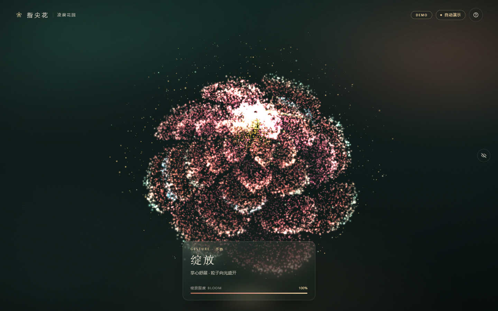
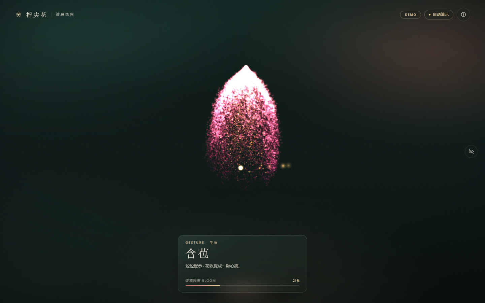

# 指尖花 · Bloom at Your Fingertips

> **在线体验：<https://cyzhou09.github.io/gesture-bloom/>**
> **GitHub：<https://github.com/cyzhou09/gesture-bloom>**

> 一束由 **22,000** 颗光尘组成的花，随着你手掌的开合，在指尖呼吸、收拢与盛放。

一个无需构建、完全本地运行的实时交互网页：摄像头识别手部 21 个关键点，Three.js 粒子花根据「握拳 / 张开」连续变化，指尖划过时花瓣会被轻轻牵引，并留下短暂的光尘尾迹。

## 预览

| 张开手掌 · 盛放 | 握拳 · 含苞 |
| --- | --- |
|  |  |

> 截图由项目内置的 `npm run qa` 在无头 Chrome 中真实渲染；实际硬件上粒子更细腻、动画更顺滑。

---

## 快速开始

需要支持摄像头和 WebGL 的 Chrome / Edge。推荐 Node.js 22+；如果只启动静态服务器，Node.js 18+ 也可以运行（内置的自动浏览器 QA 使用 Node 22 的原生 WebSocket）。

### Windows：双击启动（推荐）

解压后直接双击项目根目录的 **`start.bat`**。它会：

1. 自动检查 Node.js；
2. 在 `4173` 端口启动本地服务；
3. 等服务真正就绪后，自动打开 **<http://localhost:4173>**。

启动后保持那个终端窗口打开；按 `Ctrl+C` 停止服务。若提示端口被占用，先关闭之前启动的窗口，或改用其他端口：

```bat
start.bat 8080
```

### 命令行启动

```bash
cd gesture-bloom

# 任选一种
npm start
# 或
node serve.mjs
# 启动并自动打开浏览器（Windows / macOS / Linux）
node serve.mjs --open
```

打开 **<http://localhost:4173>**，点击「开启摄像头 · 让花绽放」，在浏览器询问时允许摄像头。

> 摄像头只能在 **localhost / HTTPS** 安全上下文中使用，请通过上面的本地服务访问，**不要直接双击 `index.html`**（`file://` 下浏览器会禁用摄像头）。

**没有摄像头？** 可以点击「无摄像头 · 进入演示」，或直接访问：

```
http://localhost:4173/?demo=1
```

低配设备 / 想让画面更轻：

```
http://localhost:4173/?demo=1&quality=low
```

### 本地自检（可选）

```bash
npm run check   # 静态完整性检查，无需浏览器
npm run qa      # 无头 Chrome 冒烟测试 + 截图（需要 Node 22+）
```

`npm run qa` 会自动启动一个临时 HTTP 服务与无头 Chrome，模拟摄像头、跑完演示模式并输出 `qa/` 截图与 `qa/qa-report.json`。

### 自定义端口

```bash
npm start -- --port 8080
# 或
PORT=8080 node serve.mjs
```

---

## 发布到 GitHub Pages（在线网址）

本项目已部署在 **<https://cyzhou09.github.io/gesture-bloom/>**，手机或电脑直接点开即可（HTTPS，
允许摄像头后即可手势控制）。下面的步骤用于你自己的 fork 或重新部署。

项目已经按 GitHub Pages 的 **子路径托管** 做好适配（所有资源走相对路径），并附带
[`.github/workflows/pages.yml`](.github/workflows/pages.yml) 自动部署工作流。

1. 在 GitHub 创建一个 **public** 仓库，例如 `gesture-bloom`；
2. 把本项目推到仓库的 `main` 分支；
3. 打开仓库 `Settings → Pages`，把 `Build and deployment → Source` 设为 **GitHub Actions**；
4. 推送后 Actions 会自动部署，通常 1–3 分钟。网址是：

```text
https://<你的GitHub用户名>.github.io/gesture-bloom/
```

也可以不用 Actions：在 `Settings → Pages` 选择 **Deploy from a branch**，分支选 `main`、目录选
`/ (root)`，根目录已带 `.nojekyll`。两种方式都不需要构建命令。

> GitHub Pages 提供 HTTPS，因此摄像头权限可以正常使用。免费账号的 Pages 需要 public 仓库。
> 如果仓库名恰好是 `<用户名>.github.io`，网址会直接是 `https://<用户名>.github.io/`。
> 第一次部署后，手机/电脑直接打开网址即可，无需安装任何东西。

---

## 项目结构

## 手势与操作

| 手势 / 按键 | 效果 |
| --- | --- |
| ✊ **握拳** | 花瓣收拢、粒子向花心聚拢，变成一颗正在呼吸的花苞 |
| 🖐 **张开手掌** | 花苞在粒子爆发的过程中向外盛放，露出金色花心 |
| 👆 **移动指尖** | 花朵轻微跟随手掌，指尖附近的花瓣被牵引、闪烁，并拖出光尾 |
| 🤏 **拇指与食指轻捏** | 光尘向花心汇聚（锦上添花，不强制） |
| `H` / `?` | 打开 / 关闭帮助面板 |
| `U` | 隐藏 / 恢复全部界面 |
| `D` | 进入程序演示模式 |
| `T` | 折叠 / 展开摄像头预览 |
| `Esc` | 关闭帮助 / 恢复界面 |

> 手势识别使用了尺度归一化 + 平滑 + 迟滞，所以手离摄像头远近、光线变化不会让花朵疯狂抖动。把整只手放进画面中部效果最好。

---

## 项目结构

```text
gesture-bloom/
├── start.bat                   # Windows 一键启动（起服务 + 开浏览器）
├── .nojekyll                   # 让 GitHub Pages 原样托管 vendor 文件
├── .github/workflows/
│   └── pages.yml               # GitHub Pages 自动部署
├── index.html                  # 页面结构、three import map
├── styles.css                  # 凌晨花园视觉系统 / 响应式 HUD
├── src/
│   ├── main.js                 # 启动、摄像头/演示状态机、统一渲染循环
│   ├── flower.js               # Three.js GPU 粒子花（花苞↔绽放、指尖交互）
│   └── handTracking.js         # MediaPipe 摄像头、21 点识别、手势数学、骨架叠加
├── vendor/
│   ├── three.module.js         # Three.js r180（本地）
│   ├── three.core.js           # Three.js 核心模块（本地）
│   ├── mediapipe/              # MediaPipe Tasks Vision + WASM（本地）
│   └── models/
│       └── hand_landmarker.task
├── serve.mjs                   # 零依赖静态服务器（正确 MIME / task / wasm）
├── tests/
│   ├── check.mjs               # 静态完整性检查
│   └── browser-qa.mjs          # Chrome headless 冒烟测试 + 截图（可选）
├── qa/                         # 独立 QA 报告、截图与复现证据
├── CONTRACT.md                 # 模块接口与协作契约（开发文档）
├── README.md
├── THIRD_PARTY_NOTICES.md      # Three.js / MediaPipe 许可
└── package.json
```

**不依赖任何外部 CDN。** Three.js、MediaPipe WASM、手部模型都已放进 `vendor/`，安装后离线也能运行。没有任何前端依赖需要 `npm install`。

---

## 实现要点

### 1. 手势 → 连续的绽放度

`handTracking.js` 不直接判断「是/不是拳头」，而是计算一个连续的 `openness ∈ [0,1]`：

- **手指伸直度**：指根到指尖的直线距离 ÷ 三节指骨长度之和；
- **指尖离心度**：五个指尖到掌心距离 ÷ 手掌尺度；
- 两者按权融合并按手掌尺度归一化，因此手离镜头远近不影响判断；
- 对 openness、掌心、指尖做指数平滑；用手势迟滞避免 UI 标签抖动；
- 握拳 ≈ 0，张开 ≈ 1，中间状态也会被保留。

### 2. GPU 粒子花

`flower.js` 把每个粒子编码为两组顶点属性：

- `aBud`：花苞中的螺旋收拢位置；
- `aBloom`：盛开时每片花瓣上的位置；
- 顶点着色器根据统一变量 `uBloom`、每颗粒子的延迟和过冲，在两组位置之间做缓动插值；
- 花瓣组按黄金角 / 多层花瓣参数生成，盛放时粒子沿径向轻微「炸开」再回落到花瓣结构；
- 指尖交互也在顶点着色器中完成：以 `uTip` 为中心计算柔性位移和闪光；
- 暖金花心、花粉与背景浮尘使用 additive blending + 柔边点精灵；
- 每帧只更新少量 uniform，不逐粒更新 CPU 数组；
- 画质档位：`high` 22,000 粒 / `balanced` 14,000 粒 / `low` 6,000 粒，DPR 同步封顶，自动按设备能力选择。

### 3. 主循环

`main.js` 是唯一的 `requestAnimationFrame`：

```
摄像头帧 ──> HandTracker.update() ──> 平滑 openness / 21 点
                                          │
                                      FlowerField.update(hand, dt)
                                          │
                                     renderer.render()
```

摄像头未启动时，场景仍会呼吸；摄像头启动但没有手时，花朵回到安静待机的状态。

---

## 隐私

- 视频流只进入浏览器内的 MediaPipe，**不会上传、不会保存**；
- 没有后端、没有埋点、没有远程请求；
- 页面关闭即释放摄像头；
- 所有模型与运行时代码均在本项目目录内。

---

## 常见问题

**双击 `start.bat` 后浏览器没有自动打开**
- 看终端里是否打印了 `Local: http://localhost:4173`，手动在 Chrome / Edge 中打开即可；
- 如果提示 Node.js 不存在，先安装 Node.js 22+；
- `.bat` 只在 Windows 上可用；macOS / Linux 请用 `npm start`。

**摄像头按钮点了没反应 / 没有权限弹窗**
- 确认使用 `http://localhost:4173`，不是 `file://`；
- 地址栏左侧摄像头图标 → 允许；
- 关闭 Zoom / 腾讯会议 / 其他占用摄像头的应用；
- Windows 设置 → 隐私 → 摄像头 → 允许桌面应用访问。

**画面很卡**
- 使用 `?quality=low`，粒子数会降到约 6,000；
- 关闭其他 GPU 应用，使用独立显卡模式；
- 外接 4K 屏时适当缩小窗口。

**看到「手部模型加载失败」**
- 确认 `vendor/mediapipe/wasm/` 与 `vendor/models/hand_landmarker.task` 文件完整；
- 必须通过 `serve.mjs` 访问（它会给 `.wasm` 正确的 MIME 类型）；
- 刷新页面重试。

**看到「无法创建 WebGL 场景」**
- Chrome → 设置 → 系统 → 开启「使用图形加速」；
- 更新显卡驱动；或在支持 WebGL2 的浏览器中打开。

**手部识别漂移 / 不灵敏**
- 手掌离摄像头约 40–80 cm，背景不要太杂；
- 手整体进入画面，光线均匀；
- 握拳时让指尖真正收向掌心，张开时五指伸直。

**HTTPS 部署**
- 该项目也可以放在任意 HTTPS 静态服务器上；但 `serve.mjs` 只提供本地 HTTP。
- 若部署到子路径，请同步修改 `index.html` 里的 import map 和 `main.js` 的绝对资源路径（当前按站点根目录设计）。

---

## 已验证环境

- Windows 11 / Chrome 156；Node.js 24
- 本地 `http://localhost:4173`
- 桌面端 1440×900、移动端 390×844、360×640 布局
- 摄像头权限、MediaPipe 模型加载、无摄像头演示模式
- `npm run check` 静态检查；`npm run qa` 18 项浏览器冒烟检查
- 独立 QA 报告：[qa/QA_REPORT.md](qa/QA_REPORT.md)

---

## Credits

- [Three.js](https://threejs.org/) r180 — MIT
- [MediaPipe Hand Landmarker](https://ai.google.dev/edge/mediapipe/solutions/vision/hand_landmarker) — Apache-2.0
- 完整许可见 [THIRD_PARTY_NOTICES.md](THIRD_PARTY_NOTICES.md)
- 视觉与交互：为本次项目从零编写

愿你的指尖，总有一朵花在等风来。 ✦
